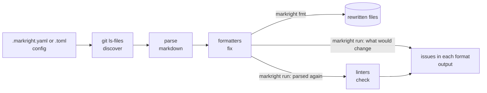
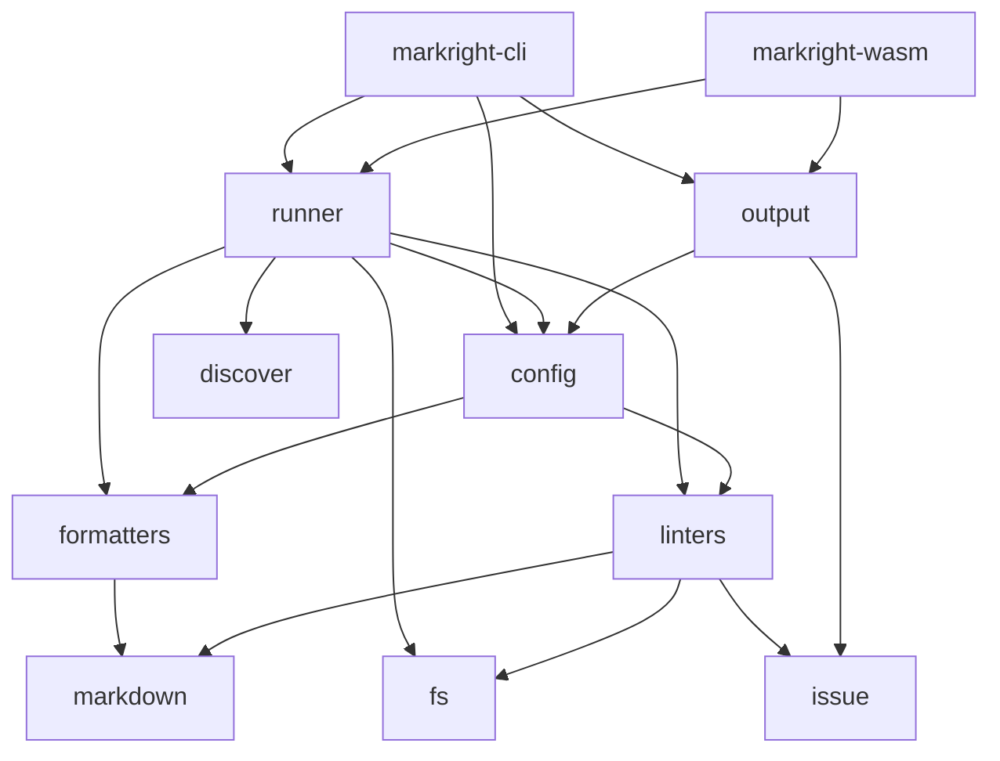

# Architecture

## A run

1. The configuration is read, or the defaults are used.
2. The Markdown documents are listed: [Document discovery](mechanisms/document-discovery.md).
3. Each document is parsed into lines, which lines are code, and the anchors its headings define.
4. The enabled formatters run in the order `markright formatters` lists them, on every document the formatter
   exclusions do not match. `fmt` writes a changed document back and stops there; `run` reports each changed line.
5. Under `run`, the formatted text is parsed again, so the linters see what the file holds after `fmt`, and every
   document's anchors are known before any link is checked.
6. The linters run per document, then `index` and `readme-links` over the whole set. Issues the linter exclusions
   match are dropped, and the rest are sorted by path and line.
7. The command writes the issues in every configured format, then warns about exclusions that matched nothing when
   `warn-unused` asks for it.

## Crates

| Crate                   | Role                                                                                       |
|-------------------------|--------------------------------------------------------------------------------------------|
| `crates/markright`      | the library: parsing, the formatters and linters, the configuration, a run, the reports    |
| `crates/markright-cli`  | the `markright` command: its subcommands and options, Ctrl+C, the exit codes               |
| `crates/markright-wasm` | one document checked in memory, compiled to WebAssembly for the playground                 |
| `xtask`                 | the project's own tasks: the tables of Rules and Configuration, and the documentation site |

The library has two features, both on by default. `disk` checks a repository on disk: it lists the documents through
Git and writes what `fmt` changes. `parallel` spreads the documents over the cores. The playground turns both off:
a page has neither a disk nor threads to spare.

## Modules

| Module       | Role                                                                                                         |
|--------------|--------------------------------------------------------------------------------------------------------------|
| `markdown`   | parsing with pulldown-cmark: code and HTML blocks, anchors, links, definitions, lazy lines, protected ranges |
| `formatters` | the formatter registry, one file per formatter                                                               |
| `linters`    | the linter registry, one file per linter, and the repository they look at                                    |
| `issue`      | an issue: where it is, what it says, which formatter or linter found it                                      |
| `fs`         | the files of a repository, as a run reads them: on disk or in memory                                         |
| `config`     | the configuration file, in YAML or TOML: the format, the defaults, choosing and excluding                    |
| `discover`   | which Markdown files belong to the repository (feature `disk`)                                               |
| `runner`     | one pass over the repository: format, lint, filter, on disk or in memory                                     |
| `output`     | writing issues as text, Checkstyle or SARIF                                                                  |

## One core, two front ends

One pass of the runner formats and lints documents read through the `Files` trait, and never writes. Two entry
points lead to it:

- `Runner::run` gives it the repository on disk, opened with `cap-std` so no path leads out of it, and writes back
  what `fmt` changed; the command uses it;
- `runner::check_documents` gives it documents held in memory, a map from path to content; the playground uses it.

Linters reach other files only through `Files`, so the same rules run everywhere without a branch for any of them.

### Spreading the work

A pass spreads its work over the cores with `rayon`: every document is read, parsed and formatted in parallel, and the
document linters then run over the documents the same way; the repository linters run after them, as they need every
document. `rayon` gives the results back in the order of the documents, and the threads only compute. What a pass
records, the issues and the exclusions that matched, it records afterwards, in the order of paths and linters, so a
run prints the same output however the work was spread. The compiler holds the threads to that: what they share is
read-only, or behind a lock.

An interrupted run, by Ctrl+C, stops at once: no new document is started, the ones being checked finish, and the
command exits with code `2`. `fmt` writes only after every document is checked, so an interrupted `fmt` writes
nothing.

A link to another document needs no look at the disk: the pass already knows every document and the directories that
hold them. Any other target is looked up once per pass. Nothing is kept from one run to the next.

## Registries

Every rule is a type of its own, such as `struct Links;`, that implements the trait of its kind. `formatters::ALL`
and `linters::ALL` list them, and are the only lists of what exists. Everything else reads them:

- the runner walks them in order;
- the `formatters` and `linters` commands print them;
- the configuration accepts exactly their names;
- `cargo xtask tables` writes the tables of [Rules](rules.md) from them, and `cargo xtask schema` the names the
  schema allows.

Each rule says what it is through `about()`: its name, its description, the release that added it and an example,
which the tests run.

The settings of the rules are types, next to the rules: `formatters::Settings` and `linters::Settings` hold one field
per rule that takes any, each a type of its own with its keys, its defaults and what it refuses, such as a limit of
zero. The configuration reads `formatters.settings` and `linters.settings` into them in the same single pass as the
rest of the file, so a key no rule defines, or a value its type refuses, is an error that names its line, in YAML
and in TOML. Each rule gets the settings of its section and reads its own field. `cargo xtask schema` generates the
JSON schema of the file from these same types, so the schema cannot say anything the code does not.

### Formatters

A formatter implements `Formatter`. Besides its name and description, its `about()` gives the message `run` prints for
a line it would change. Its `apply` takes the parsed document and the settings of the formatters, and returns a `Fix`:
the new lines and the numbers of the lines it changed. The parser is the only judge of the document's structure: which
lines are code, where its lists and tables are, which ranges to leave as written. No formatter reads that from the
text on its own.

A formatter may add or remove lines. `run` applies each formatter to the file as read, so the line numbers it reports
are the file's own. `fmt` parses the document again after every change, so the next formatter sees the document as
it is now.

### Linters

A linter implements one of two traits, and `linters::ALL` holds it as the matching variant of `Linter`, so each linter
is exactly one kind:

- a `DocumentLinter` runs once per document;
- a `RepositoryLinter` runs once over every document, for rules about the whole set, such as `index`.

Both get a context with the repository, the settings of the linters and the path exclusions. They return findings:
where a problem is and what it is. The runner makes each finding an issue that names the linter, and drops those
the exclusions match, so no linter filters for itself.
